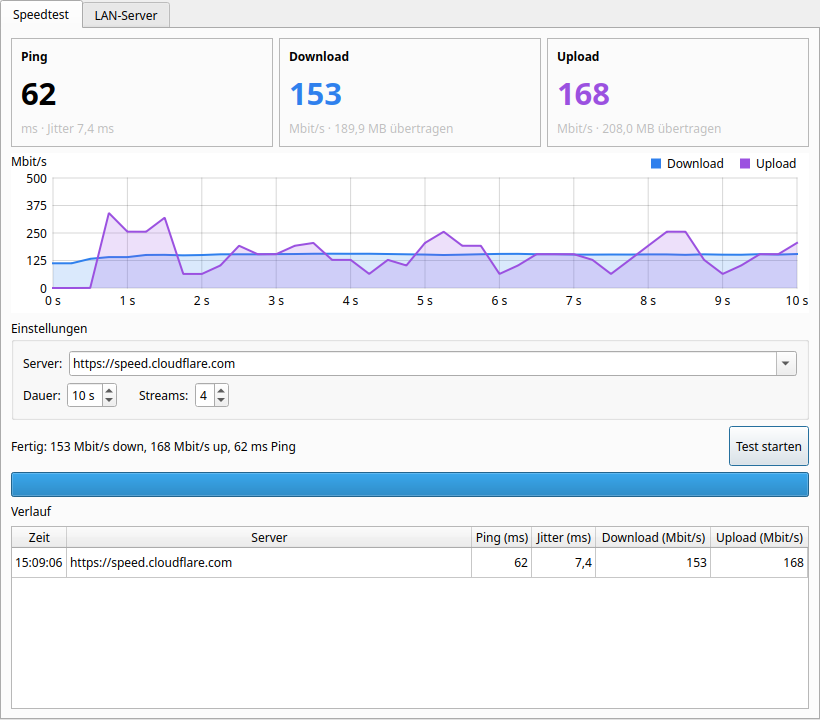
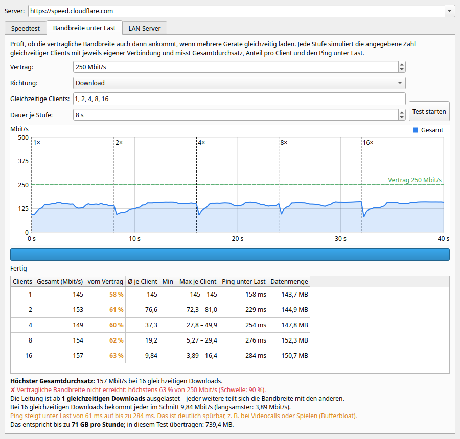

# broadband

Ein einfacher **Speedtest und Bandbreitentest** mit Qt 6 GUI, geschrieben in C++17. Läuft unter Linux, Windows und macOS.

- **Speedtest:** Ping, Jitter, Download und Upload, gemessen gegen [speed.cloudflare.com](https://speed.cloudflare.com), mit Live-Diagramm
- **Bandbreite unter Last:** Kommt die vertraglich zugesagte Bandbreite auch dann an, wenn mehrere Geräte gleichzeitig laden? Das Programm simuliert stufenweise 1, 2, 4, 8, 16 … gleichzeitige Clients und zeigt pro Stufe Gesamtdurchsatz, Anteil pro Client, Ping unter Last und Prozent vom Vertrag.
- **LAN-Test** zwischen zwei eigenen Rechnern. Der passende Testserver ist eingebaut, mit GUI oder headless.
- **Messreihen:** Tests mehrmals nacheinander ausführen, mit Pause dazwischen. Das Programm erkennt Ausreißer und Trends und sagt, ob die Werte belastbar sind oder nur ein Zufallstreffer waren.
- **Excel-Export** aller Messungen als gestaltete Arbeitsmappe (.xlsx) mit Übersicht, Auswertung und Diagrammen
- Keine Abhängigkeiten außer Qt (Widgets + Network)



## Inhalt

- [Funktionsweise](#funktionsweise)
- [Bandbreite unter Last](#bandbreite-unter-last)
- [Messreihen und Excel-Export](#messreihen-und-excel-export)
- [Windows](#windows)
- [Bauen](#bauen)
- [Benutzung](#benutzung)
- [Tests](#tests)
- [Projektstruktur](#projektstruktur)
- [Hinweise zur Messgenauigkeit](#hinweise-zur-messgenauigkeit)
- [Sicherheit und Datenschutz](#sicherheit-und-datenschutz)

## Funktionsweise

Der Test läuft in drei Phasen:

| Phase    | Was passiert                                                                                   | Ergebnis              |
|----------|------------------------------------------------------------------------------------------------|-----------------------|
| Latenz   | 1 + 10 kleine HTTP-Requests nacheinander. Der erste baut die Verbindung auf und zählt nicht.   | Median-Ping, Jitter   |
| Download | *n* parallele Verbindungen laden für die eingestellte Dauer fortlaufend Daten (je 25 MB).     | Mbit/s                |
| Upload   | *n* parallele Verbindungen senden fortlaufend zufällige Daten (je 8 MB).                       | Mbit/s                |

- **Jitter** ist die mittlere Abweichung zwischen aufeinanderfolgenden Ping-Messungen (wie in RFC 3550).
- Die ersten **20 %** jeder Transferphase gelten als Aufwärmzeit (TCP Slow Start) und fließen nicht ins Ergebnis ein.
- Das Live-Diagramm zeigt einen gleitenden Mittelwert über 1 Sekunde.
- Es wird bewusst **HTTP/1.1** verwendet, damit jeder Stream eine eigene TCP-Verbindung bekommt. Bei HTTP/2 würden alle Streams über eine einzige Verbindung laufen.
- Die Upload-Daten sind zufällig, damit komprimierende Proxys das Ergebnis nicht verfälschen.

### Protokoll

Client und eingebauter Server sprechen dasselbe einfache HTTP-Protokoll wie Cloudflare:

```
GET  /__down?bytes=N    → Antwort mit N Bytes
POST /__up              → Request-Body wird gelesen und verworfen
```

Deshalb funktioniert jeder kompatible Server als Ziel, sowohl Cloudflare als auch `broadband --server`.

## Bandbreite unter Last

Der Speedtest zeigt, wie schnell die Leitung **maximal** ist. Im Alltag laden aber oft mehrere Geräte gleichzeitig, und genau dann wird es häufig deutlich schlechter. Der Tab **Bandbreite unter Last** prüft diesen Fall:



1. Die vertragliche Bandbreite eintragen, z. B. 250 Mbit/s. Das ist optional.
2. Die Stufen wählen, standardmäßig `1, 2, 4, 8, 16` gleichzeitige Clients, und die Dauer je Stufe festlegen.
3. **Test starten**

Zuerst misst das Programm den Ping im Leerlauf. Danach läuft pro Stufe die angegebene Zahl Clients gleichzeitig. Jeder Client hat eine **eigene Verbindung**, verhält sich also wie ein eigenes Gerät. Die Tabelle zeigt pro Stufe:

| Spalte              | Bedeutung                                                                       |
|---------------------|---------------------------------------------------------------------------------|
| Gesamt              | Summe aller Clients: Wie viel liefert die Leitung insgesamt?                    |
| vom Vertrag         | Gesamt im Verhältnis zur vertraglichen Bandbreite (grün ab 90 %)                |
| Ø / Min – Max       | Wie viel bekommt jeder einzelne Client, und wie gerecht wird geteilt?           |
| Ping unter Last     | Reaktionszeit, während die Leitung voll ist (Stichwort *Bufferbloat*)           |
| Datenmenge          | Übertragene Daten in dieser Stufe                                               |

Darunter steht eine Auswertung in Klartext: ob der Vertrag erreicht wird, ab wie vielen Clients die Leitung voll ist, ob der Gesamtdurchsatz bei vielen Clients einbricht, wie stark der Ping steigt und wie viele GB pro Stunde das entspricht.

**Tipps:**
- Für einen **Dauertest**, etwa gegen Drosselung oder abendliche Engpässe, eine einzelne Stufe mit langer Dauer wählen: Stufen `8`, Dauer `300 s`. Einbrüche sind dann im Verlauf gut zu sehen.
- Die Schwelle von 90 % entspricht der Vorgabe der Bundesnetzagentur für die vertragliche Maximalgeschwindigkeit. Rechtlich verwertbar, z. B. für eine Minderung, ist aber nur eine Messung mit der offiziellen [Breitbandmessung](https://breitbandmessung.de).
- Das Programm simuliert mehrere Clients **von einem Rechner aus**. Das testet den Anschluss. Echte Geräte im WLAN teilen sich zusätzlich die Funkzelle. Wenn das WLAN der Engpass ist, stellt man den Rechner zum Vergleich einmal per Kabel direkt an den Router.

## Messreihen und Excel-Export

Eine einzelne Messung kann täuschen: Ein Update im Hintergrund, ein kurzer Engpass beim Provider, und schon ist der Wert nur halb so hoch. Deshalb lassen sich beide Tests **mehrmals nacheinander** ausführen:

- **Speedtest:** *Wiederholungen* und *Pause* einstellen, z. B. `5 ×` mit `30 s` Pause. Für eine Beobachtung über den Abend eignen sich z. B. `20 ×` mit `600 s`.
- **Bandbreite unter Last:** *Durchläufe* und *Pause dazwischen* einstellen. Das Diagramm zeigt alle Durchläufe hintereinander. Ausgewertet wird der Median je Stufe.

Nach jeder Messung wird die Serie neu ausgewertet:

| Kennzahl    | Bedeutung                                                                                                   |
|-------------|-------------------------------------------------------------------------------------------------------------|
| Median      | Der mittlere Wert der Serie. Einzelne Ausreißer beeinflussen ihn kaum, deshalb ist er die Hauptkennzahl.     |
| Schwankung  | Standardabweichung im Verhältnis zum Mittelwert: unter 5 % sehr stabil, unter 15 % stabil, darüber schwankend |
| Ausreißer   | Messungen, die weit vom Rest abweichen (mehr als 3 robuste Standardabweichungen und mehr als 10 %). Ab 3 Messungen. |
| Trend       | Steigen oder fallen die Werte über die Serie hinweg um mindestens 10 %? Ab 4 Messungen.                     |

Ausreißer werden im Verlauf rot markiert. Die Schwankung bewertet das Programm ohne die Ausreißer: Ein einzelner Fluke macht die Leitung nicht „instabil“, er wird aber ausdrücklich benannt. Ein fallender Trend deutet auf zunehmende Auslastung (abends) oder eine Drosselung hin.

**Excel-Export …** speichert alle Messungen der Sitzung als `.xlsx`. Die Datei lässt sich mit Excel und LibreOffice Calc öffnen:

- **Übersicht:** Kennzahlen je Server (Mittelwert, Median, Min, Max, Standardabweichung, Schwankung) mit farbiger Bewertung, Ausreißern, Trend und der Auswertung in Klartext
- **Speedtest:** jede Messung mit Abweichung vom Median, markierten Ausreißern, Autofilter, Formeln für Mittelwert/Median/Min/Max und Diagrammen für Download/Upload und Ping/Jitter je Messung
- **Bandbreite unter Last:** jede Stufe jedes Durchlaufs und ein Diagramm mit einer Linie pro Durchlauf, sodass Abweichungen sofort auffallen

Mit **Verlauf leeren** beginnt eine neue Sammlung, z. B. vor einer Messreihe an einem anderen Ort.

## Windows

### Fertiges Paket

`broadband-<version>-windows-x64.zip` entpacken und `broadband.exe` starten. Eine Installation ist nicht nötig. Das Paket enthält nur die benötigten Qt- und MinGW-Laufzeit-DLLs. HTTPS läuft über den TLS-Stack von Windows (Schannel), OpenSSL wird nicht mitgeliefert.

Die `.exe` ist nicht digital signiert. Deshalb zeigt Windows SmartScreen beim ersten Start eventuell „Der Computer wurde durch Windows geschützt“. Über *Weitere Informationen → Trotzdem ausführen* startet das Programm.

### Unter Windows selbst bauen

Qt über den [Qt Online Installer](https://www.qt.io/download-qt-installer) installieren, mit der Komponente *MinGW 13.1* (oder MSVC). Danach in der „Qt 6.x (MinGW)“-Eingabeaufforderung:

```bat
cmake -S . -B build -G "MinGW Makefiles" -DCMAKE_BUILD_TYPE=Release
cmake --build build -j
windeployqt --release build\broadband.exe
```

### Unter Linux für Windows cross-kompilieren

Benötigt den MinGW-w64-Cross-Compiler (`sudo apt install g++-mingw-w64-x86-64-posix`) und Qt für *Windows/MinGW* sowie Qt für *Linux* (Host-Tools wie `moc`), jeweils in **derselben Version**. Beides bekommst du z. B. mit dem Qt Online Installer oder mit [aqtinstall](https://github.com/miurahr/aqtinstall).

```bash
cmake -S . -B build-win -DCMAKE_BUILD_TYPE=Release \
    -DCMAKE_TOOLCHAIN_FILE=cmake/mingw-w64-x86_64.cmake \
    -DCMAKE_PREFIX_PATH=~/Qt/6.8.3/mingw_64 \
    -DQT_HOST_PATH=~/Qt/6.8.3/gcc_64
cmake --build build-win -j

# ZIP mit exe und den benötigten DLLs erzeugen
scripts/package-windows.sh build-win ~/Qt/6.8.3/mingw_64 \
    /usr/lib/gcc/x86_64-w64-mingw32/13-posix /usr/x86_64-w64-mingw32/lib
```

`package-windows.sh` wertet die Import-Tabellen der exe aus und kopiert nur die DLLs, die tatsächlich geladen werden. Am Ende listet es auch die Windows-Systembibliotheken auf, die das Programm verwendet.

Die CI (`.github/workflows/build.yml`) baut und testet zusätzlich nativ unter Windows und stellt das Ergebnis als Artefakt bereit.

## Bauen

Voraussetzungen: **CMake ≥ 3.19**, ein **C++17-Compiler** und **Qt ≥ 6.2** (Module *Widgets* und *Network*).

### Abhängigkeiten installieren

| System          | Befehl                                                                   |
|-----------------|--------------------------------------------------------------------------|
| Ubuntu / Debian | `sudo apt install build-essential cmake qt6-base-dev libgl1-mesa-dev`    |
| Fedora          | `sudo dnf install gcc-c++ cmake qt6-qtbase-devel`                        |
| Arch Linux      | `sudo pacman -S base-devel cmake qt6-base`                               |
| macOS           | `brew install cmake qt`                                                  |
| Windows         | siehe [Windows](#windows)                                                |

### Kompilieren

```bash
cmake -S . -B build -DCMAKE_BUILD_TYPE=Release
cmake --build build -j
./build/broadband
```

Liegt Qt nicht im Standardpfad (z. B. auf macOS oder Windows), gibst du den Pfad beim Konfigurieren mit an:

```bash
cmake -S . -B build -DCMAKE_PREFIX_PATH="$(brew --prefix qt)"      # macOS
cmake -S . -B build -DCMAKE_PREFIX_PATH=C:/Qt/6.8.3/mingw_64       # Windows
```

Installieren (optional): `cmake --install build --prefix ~/.local`

## Benutzung

### Speedtest

1. `broadband` starten
2. Oben ist als Server `https://speed.cloudflare.com` voreingestellt. Die Adresse gilt für alle Tests.
3. Optional Messdauer (je Richtung), Anzahl paralleler Streams und Wiederholungen anpassen
4. **Test starten**

Die Ergebnisse einer Sitzung erscheinen unten im Verlauf. Die Einstellungen bleiben zwischen den Starts gespeichert.

### Bandbreite im LAN messen

Auf **Rechner A** (Server):

```bash
broadband --server            # headless, Port 8080
broadband --server -p 9000    # anderer Port
```

Alternativ startest du den Server in der GUI im Tab **LAN-Server**. Dort werden auch die Adressen angezeigt, unter denen der Rechner erreichbar ist.

Auf **Rechner B** (Client) trägst du als Server `http://<IP-von-A>:8080` ein und startest den Test. Das geht auch direkt beim Start:

```bash
broadband --url http://192.168.1.20:8080
```

> Die Firewall auf Rechner A muss eingehende Verbindungen auf dem Port zulassen, z. B. mit `sudo ufw allow 8080/tcp`.

### Kommandozeile

```
Usage: broadband [options]

  -h, --help         Hilfe anzeigen
  -v, --version      Version anzeigen
  -s, --server       Nur den LAN-Testserver starten (ohne GUI)
  -p, --port <port>  Port des Testservers (Standard: 8080)
  -u, --url <url>    Server-Adresse, die in der GUI vorausgewählt wird
```

### Proxy

broadband übernimmt die Proxy-Einstellungen des Systems, unter Linux also `http_proxy`, `https_proxy` und `no_proxy`. Private Adressen (`localhost`, `10.x`, `172.16–31.x`, `192.168.x`, `fe80::`, `fc00::/7`) werden immer direkt angesprochen, damit LAN-Tests nicht über einen Firmen-Proxy laufen. Bei Hostnamen im LAN hilft ein Eintrag in `no_proxy`.

## Tests

Die Unit-Tests starten einen lokalen Testserver und prüfen die Server-Endpunkte, einen kompletten Speedtest, den Lasttest mit mehreren Stufen, darunter mehr als 6 parallele Clients, jeweils in Download- und Upload-Richtung, das Abbrechen und den Fall, dass keine Verbindung zustande kommt. `tst_report` prüft die Statistik (Median, Ausreißer, Trend), die Auswertungstexte und die erzeugte Excel-Datei bis hinunter zu ZIP-Prüfsummen und gültigem XML. Sie werden automatisch mitgebaut, wenn Qt6 *Test* installiert ist. Unter Debian und Ubuntu ist das in `qt6-base-dev` enthalten.

```bash
cmake --build build
ctest --test-dir build --output-on-failure
```

Mit `-DBROADBAND_BUILD_TESTS=OFF` lassen sie sich abschalten.

## Projektstruktur

```
.
├── CMakeLists.txt
├── cmake/mingw-w64-x86_64.cmake  Toolchain für den Windows-Cross-Build
├── scripts/package-windows.sh    Windows-ZIP mit allen benötigten DLLs erzeugen
├── src/
│   ├── main.cpp              Einstieg, Kommandozeile, GUI- oder Server-Modus
│   ├── SpeedTest.{h,cpp}     Speedtest: Latenz, Download, Upload
│   ├── LoadTest.{h,cpp}      Bandbreite unter Last: Stufen mit N gleichzeitigen Clients
│   ├── HttpCommon.{h,cpp}    Gemeinsame HTTP-Helfer (Requests, Proxy, Testdaten)
│   ├── Statistics.h          Median, Streuung, Ausreißer und Trend einer Messreihe
│   ├── Report.{h,cpp}        Auswertung in Klartext und Aufbau der Excel-Arbeitsmappe
│   ├── XlsxWriter.{h,cpp}    Minimaler .xlsx-Writer (ZIP, Formate, Diagramme) ohne Zusatzbibliothek
│   ├── TestServer.{h,cpp}    Minimaler HTTP/1.1-Server für LAN-Tests (QTcpServer)
│   ├── MainWindow.{h,cpp}    Hauptfenster mit Speedtest-, Last- und Server-Tab
│   ├── ThroughputChart.{h,cpp}  Live-Diagramm (QPainter, ohne Qt Charts)
│   ├── broadband.rc.in       Versionsinfo für die Windows-exe
│   └── Format.h              Zahlenformatierung
├── tests/
│   ├── tst_speedtest.cpp     Tests für Messung und Testserver
│   └── tst_report.cpp        Tests für Statistik, Auswertung und Excel-Export
└── .github/workflows/build.yml  CI: Build und Tests unter Ubuntu und Windows
```

`SpeedTest`, `LoadTest`, `TestServer` und der Excel-Export bilden die Bibliothek `broadband_core`, die von App und Tests gemeinsam genutzt wird. Die Engine hängt nicht von Qt Widgets ab und lässt sich deshalb auch in einem reinen Kommandozeilen-Tool verwenden.

## Hinweise zur Messgenauigkeit

- Ergebnisse schwanken naturgemäß. Den besten Wert bekommst du **per Kabel** und ohne andere Downloads nebenher.
- Bei sehr schnellen Anschlüssen (≥ 1 Gbit/s) helfen mehr Streams (max. 6, das ist Qts Grenze pro Host) und eine längere Messdauer.
- Der Upload wird über den Sendefortschritt gemessen. Hinter einem puffernden Proxy kann der Wert deshalb etwas zu hoch ausfallen.
- Der Ping ist ein **HTTP-Ping** (Request/Response über eine bestehende Verbindung). Er liegt etwas über dem ICMP-`ping`, dafür braucht er keine Root-Rechte.
- Die Cloudflare-Endpunkte sind nicht offiziell dokumentiert. Bitte nutze sie in Maßen und nicht für Dauermessungen im Minutentakt. Für lange Messreihen eine Pause von einigen Minuten einstellen.

## Sicherheit und Datenschutz

Das Programm ist bewusst klein gehalten und lässt sich vollständig prüfen:

- **Netzwerk:** Es gibt genau drei Arten von Anfragen, ausschließlich an den eingestellten Server (Standard: `speed.cloudflare.com`): `GET /__down?bytes=0` (Ping), `GET /__down?bytes=25000000` (Download), `POST /__up` (Upload). Es gibt keine Telemetrie, keine Update-Prüfung und keine weiteren Hosts. Der Server sieht dabei, wie bei jedem Speedtest, deine IP-Adresse und den User-Agent `broadband/<version>`.
- **Downloads** landen nur im Arbeitsspeicher, werden gezählt und sofort verworfen. Es wird **nichts auf die Festplatte geschrieben und nichts ausgeführt**.
- **Uploads** bestehen aus zufällig erzeugten Daten. Es werden nie Dateien oder andere Daten von deinem Rechner gesendet.
- **Auf der Festplatte** speichert das Programm nur seine Einstellungen (Server, Dauer, Streams, Wiederholungen, Stufen, Vertrag, Port, zuletzt genutzter Export-Ordner) über `QSettings`: unter Linux in `~/.config/broadband/broadband.conf`, unter Windows in der Registry unter `HKCU\Software\broadband`. Dazu kommt der Excel-Bericht, aber nur wenn du ihn über **Excel-Export …** ausdrücklich an einem selbst gewählten Ort speicherst. Er enthält nur Messwerte, Zeitpunkte und die Server-Adresse.
- Es werden **keine anderen Programme gestartet** (kein `QProcess`, kein `system()`).
- **LAN-Server:** Nur solange er ausdrücklich gestartet ist, lauscht er auf allen Netzwerkschnittstellen und ohne Passwort. Er liefert ausschließlich Zufallsdaten und liest nichts von der Platte. Jemand im selben Netz könnte damit aber Bandbreite verbrauchen. Nutze ihn deshalb nur in vertrauenswürdigen Netzen und beende ihn nach dem Test.

## Lizenz

[MIT](LICENSE)
